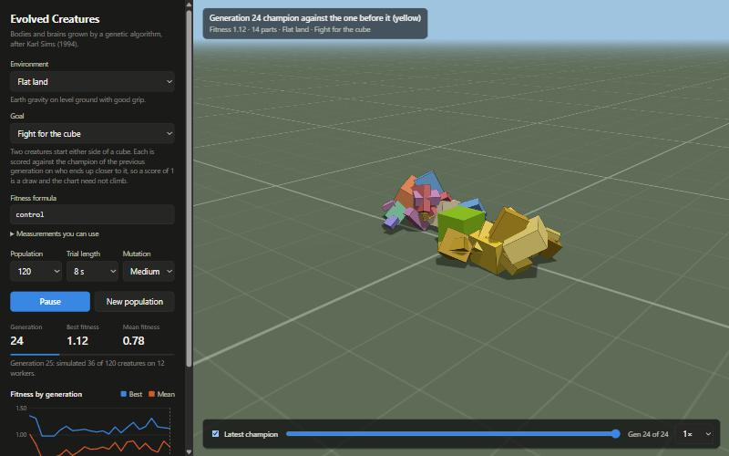

# Evolved Creatures

A browser app that evolves 3D virtual creatures with a genetic algorithm, after
Karl Sims' 1994 work on
[evolved virtual creatures](https://www.karlsims.com/evolved-virtual-creatures.html).
You pick an environment and a goal, press start, and watch bodies and brains
improve generation by generation.



*The champion of generation 24 contesting the cube with its predecessor (in yellow).*

Nothing is designed by hand. Each creature's shape and its control system both
come from a genome, and the only guidance is a fitness score.

## Running it

You need [Node.js](https://nodejs.org) 20.19 or later, or 22.12 or later.

```bash
npm install
npm run dev
```

Then open the address Vite prints (by default http://localhost:5173).

To build a static version into `dist/`:

```bash
npm run build
```

## Using it

1. Choose an **environment** and a **goal**.
2. Press **Start evolving**. The view shows the champion of the latest
   generation, replayed in the same simulation it was scored in.
3. Click the fitness chart, or drag the slider under the view, to replay the
   champion of any earlier generation.

You can change the environment or goal while a run is going. The population
carries over, so you can, for example, take evolved walkers and make them learn
to swim.

**Save run** writes the population and its history to a JSON file, and **Load
run** restores it.

### Environments

| Environment | What it is |
|---|---|
| Flat land | Earth gravity, level ground, good grip |
| Hills | Earth gravity, rolling terrain |
| Water | No gravity and no ground; surfaces moving through the water are pushed back |
| Moon | One-sixth gravity, level ground |
| Ice | Earth gravity, level ground, almost no grip |

### Goals

| Goal | Formula | What is rewarded |
|---|---|---|
| Travel far | `distance` | Ending up far from the start (walking or swimming) |
| Follow the light | `approach` | Getting close to a target, tested in three positions |
| Jump | `maxClearance` | Getting the whole body off the ground |
| Stand tall | `avgTop` | Keeping the highest point high |
| Spin | `spin` | Turning about the vertical axis |
| Fight for the cube | `control` | Ending up closer to a cube than a rival creature |
| Travel efficiently | `distance / (0.15 + effort)` | Distance for little muscle activity |

A goal is just a formula over measurements taken during the simulation, so you
can type your own into the **Fitness formula** box, for example
`distance - 2 * effort` or `control + 0.1 * distance`. The app lists every
available measurement under "Measurements you can use". Higher is fitter.

### Fight for the cube

Two creatures start on opposite sides of a cube and are scored on who finishes
closer to it: `1 + (rival - self) / (rival + self)`, so 1 is a draw, 2 is total
control and 0 is total defeat.

- Every creature fights the champion of the previous generation.
- Each starts set back from the cube by at least its own height, so a tall
  creature cannot win by falling over.
- The two creatures collide with each other and with the cube, so they can
  push, block and pin.
- The rival is drawn in yellow.

Because the opponent keeps improving, the fitness chart hovers around 1 instead
of climbing. Progress shows in the replays.

## How it works

**Genotype.** A genome is a directed graph of nodes. Each node describes a box,
the hinge joining it to its parent, and a small neural circuit. Connections say
where child parts attach. A node can connect to itself (repeated segments) and
a connection can be reflected (mirrored limbs), so a short genome can describe
a body with many parts.

**Body.** The graph is grown into a tree of up to 14 boxes joined by motorised
hinges. Muscle strength scales with cross-section area.

**Brain.** Every part has sensors for its joint angle, ground contact, tilt,
the direction of the target (or cube) and the direction of the rival. Its
neurons (oscillators, sums, thresholds, smoothing and others) can read those
sensors and the neurons of neighbouring parts, and one signal per part drives
its joint.

**Evolution.** The top fifth of each generation survives. The rest of the next
generation is bred from them by mutation, crossover and grafting, with a few
fresh random creatures added for diversity.

**Simulation.** Physics is [Rapier](https://rapier.rs) at 60 steps per second.
Fitness is evaluated in a pool of Web Workers, one per spare CPU core. The
simulation is deterministic, so a replay matches the scored run exactly.

### Differences from Sims' original

- Joints are single-axis hinges; the original had several joint types.
- Parts of the same creature do not collide with each other.
- Muscles have a speed limit, and light parts get a minimum mass relative to
  their neighbours. Both exist to stop evolution exploiting physics glitches.
- The cube contest uses one population scored against the previous champion.
  Sims' most striking results came from two species evolving against each
  other, which is not implemented.

## Project layout

| File | Contents |
|---|---|
| `src/genome.js` | Genome structure, random genomes, mutation, crossover, grafting |
| `src/phenotype.js` | Growing a body from a genome |
| `src/sim.js` | Physics, sensors, neural circuits, muscles, measurements |
| `src/environments.js` | Environment definitions and terrain |
| `src/goals.js` | Measurements, preset goals, formula compiler |
| `src/evolve.js` | Selection and breeding |
| `src/worker.js`, `src/pool.js` | Parallel fitness evaluation |
| `src/viewer.js` | 3D playback with three.js |
| `src/chart.js` | Fitness chart |
| `src/main.js` | UI and the evolution loop |
| `test/headless.mjs` | Evolution in Node, without a browser |

To add an environment or a goal, add an entry to `ENVS` in
`src/environments.js` or `GOALS` in `src/goals.js`.

## Headless runs

The simulation core has no browser dependencies, so evolution can run in Node:

```bash
node test/headless.mjs <environment> <goal> <generations> <population>
```

For example, `node test/headless.mjs water travel 20 100`. It prints the best
and mean fitness per generation, then replays the final champion to confirm the
simulation is deterministic.

## Reference

- Karl Sims, "Evolving Virtual Creatures", SIGGRAPH 1994.
- Karl Sims, "Evolving 3D Morphology and Behavior by Competition", Artificial
  Life IV, 1994.
